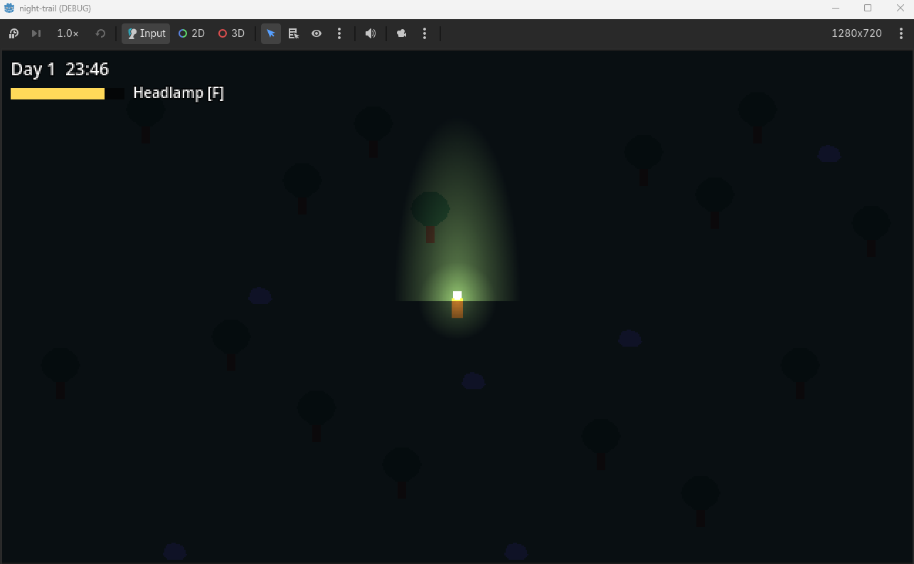
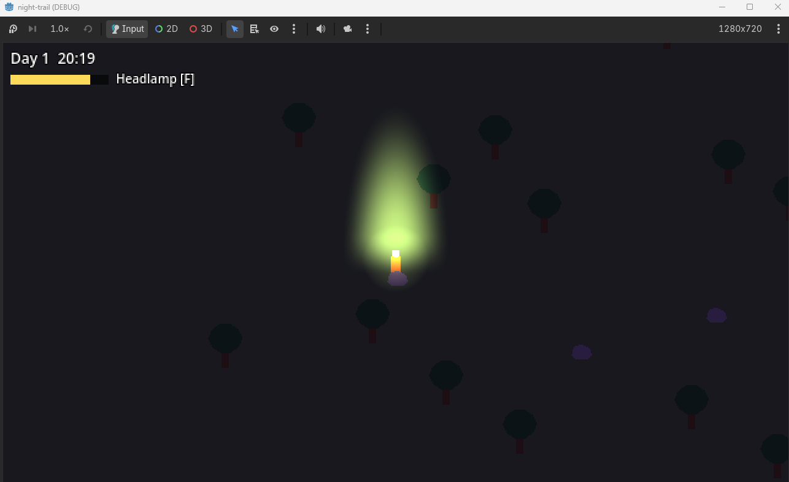
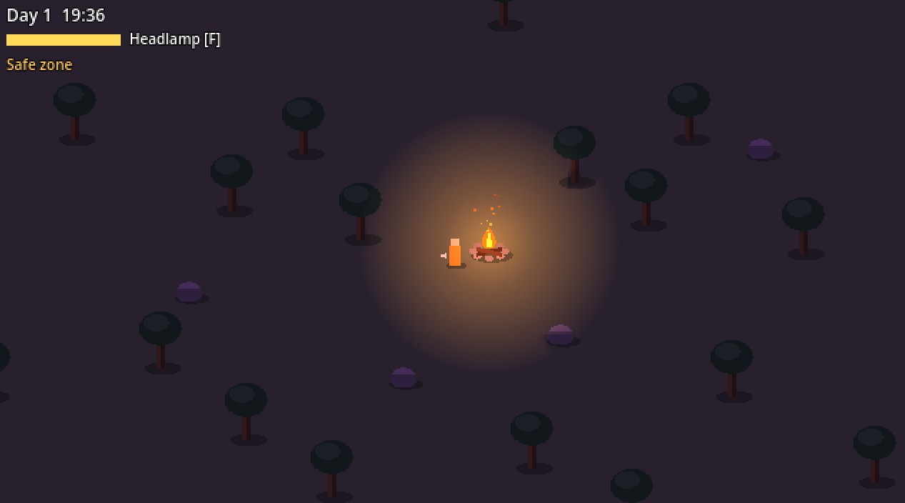

# Sprint 1 – Lighting prototype

Goal: check that darkness, lights and shadows work in 2D.

## What I did

- Set up the project (Godot 4.7.2, GitHub)
- Player movement
- Day/night cycle
- Headlamp with battery
- Campfire with a safe zone
- Shadows from trees and rocks

## Problems & solutions

### Night was too dark
You couldn't see anything without light. I made the night lighter and bluer, so trees still show as silhouettes.

 

### The headlamp looked green
Light multiplies with the surface colour, and the grass was too green. I made the light warmer and the grass less saturated.

 

### Hard line at the base of the light beam
The built-in gradient couldn't fade in near the player, so the beam texture is now generated in code with a soft start.

### The headlamp was too bright in the daytime
Lights now get brighter only when it gets dark.

### Tree tops were getting shadows from trunks
I put the tree tops on a separate light layer that doesn't get shadows.

### Tree shadows looked like thin spikes
I made the shadow shape wider and the shadows softer.

## Media

Video: day → sunset → night, headlamp, shadows, campfire.

[demo.mp4](../../media/sprint-1/demo.mp4)

## Useful links

- [Godot docs – 2D lights and shadows](https://docs.godotengine.org/en/stable/tutorials/2d/2d_lights_and_shadows.html)
- [Game Programming Patterns – State](https://gameprogrammingpatterns.com/state.html)

## Next steps

Sprint 2 is about light as a resource:

- Cold in the dark
- Firewood for the campfire
- Torches
- Battery pickups
- Waking up at camp if the light runs out
