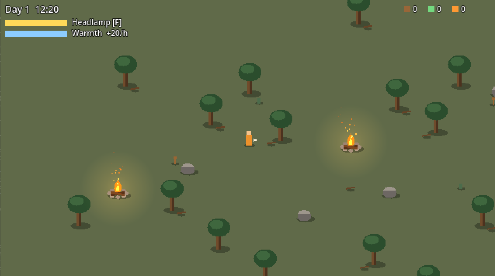
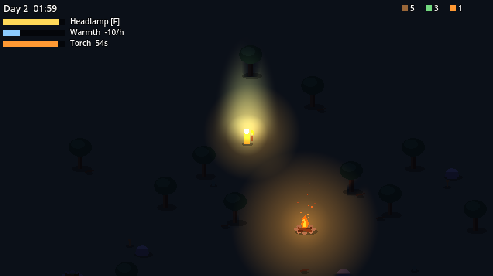
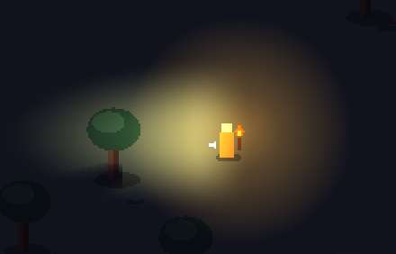
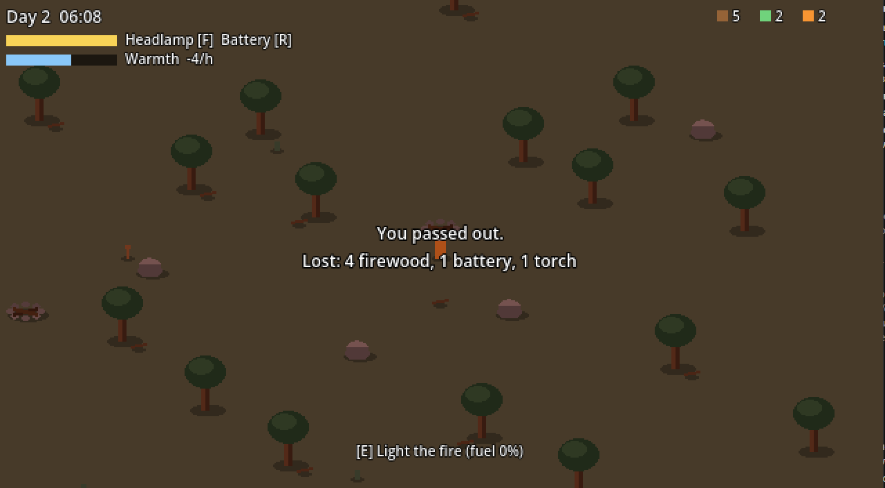
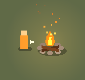
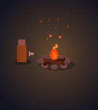
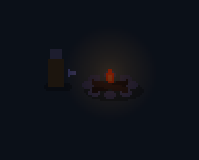
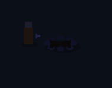

# Sprint 2 – Light as a resource

**Goal:** make it possible to survive or lose the night.

## What I did

- Pick up items with E: firewood, batteries, torches
- Items placed around the map
- Campfire burns fuel: big fire → small fire → embers → out
- Add firewood to keep the fire going
- Warmth meter: you get cold at night, warm up by the fire
- Torch (Q): lasts about a minute, gives light and some warmth
- Battery (R) recharges the headlamp
- If warmth hits zero, you pass out and wake up at the last campfire, losing half your items

## Problems & solutions

### Fuel burned in real time, but the day used game time
Testing and balance didn't match. Now everything uses game time.

### You could survive the night with just the headlamp
Campfires didn't matter. Now only fire gives warmth, the headlamp only gives light.

### Headlamp + torch made the player look blown out
Lights add up. Now the headlamp glow fades out while the torch is lit.

 

### Items were too easy to see at night
Made their colours dimmer, so you need light to find them.

## Balance check

- By the campfire: survived the night, used 7 firewood
- Torches only: ran out of warmth 35 minutes before dawn
- No light: passed out at 3:30, woke up at the campfire

## Playtest

I gave the game to a friend without explaining anything except the controls.

- Controls felt clear and comfortable, and he understood the goal by himself.
- He asked if you can get hurt by the fire. There's no health, so instead the fire will be solid and you can't walk into it.
- He suggested food. Food will give warmth (and more if cooked at the fire) instead of adding health.
- He asked if you can sleep. Sleeping through the night would remove the challenge, so resting will only be possible at a burning campfire, and the fire keeps using fuel while you sleep.
- He suggested different biomes and snow higher up. This matches the plan (forest → ridge → pass), and I'll add "higher = colder".

## Media

Campfire burning down, in order:

   

## Next steps

- Campsites as save points
- Firewood that grows back each day
- Main menu and pause
- Solid campfire
