# Sprint 3 – Campsites, saving and menus

**Goal:** make it feel like a real game – progress is saved, there are menus, and the world goes on day after day.

## What I did

- The campfire is solid – you can't walk into the fire
- Firewood grows back every morning (each pile with a 70% chance)
- Apples: eat with C for warmth, or cook them at the fire for more
- Campfire menu (E): add firewood, cook, rest
- Rest 2 hours at a burning campfire – the fire keeps burning while you rest
- Saving: autosave at campfires and at dawn, Continue from the main menu
- Main menu, pause menu (Esc) and settings: brightness, volume, fullscreen, controls

## Problems & solutions

### You could stand on the campfire stones
The collision was a small circle in the middle. Now it matches the ring of stones.

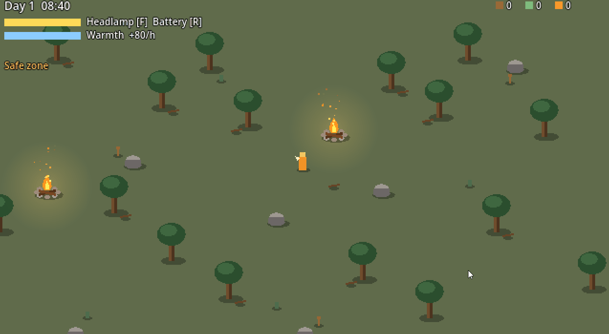

### Firewood disappeared forever
After 2–3 nights the map was empty. Now picked-up items are hidden and come back at dawn.

### The game overwrote your save at the start
The player starts next to a campfire, which counted as a visit and autosaved. Now autosave waits until you load or start a new game.

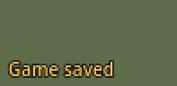

### Resting could surprise you
You didn't know if the fire would last. Now the menu warns "fire may go out" in red.

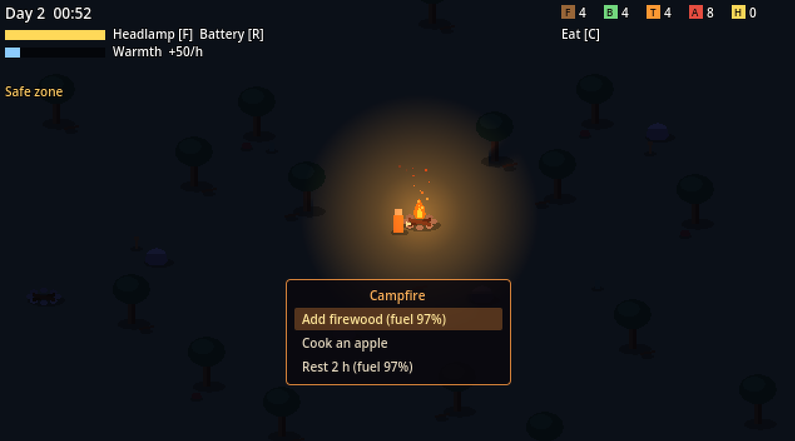 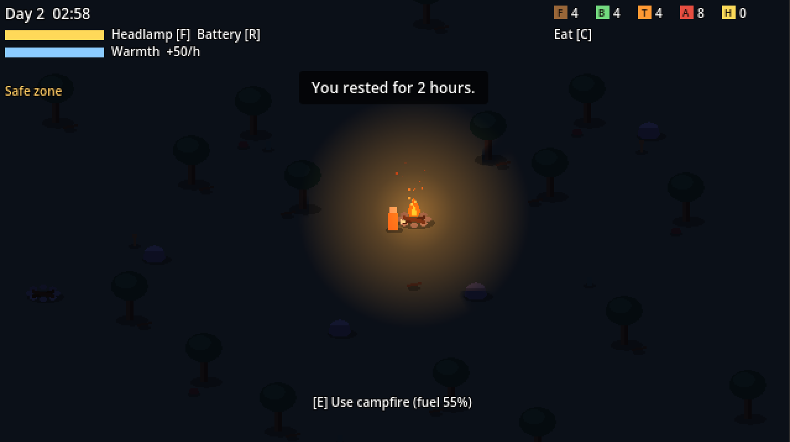 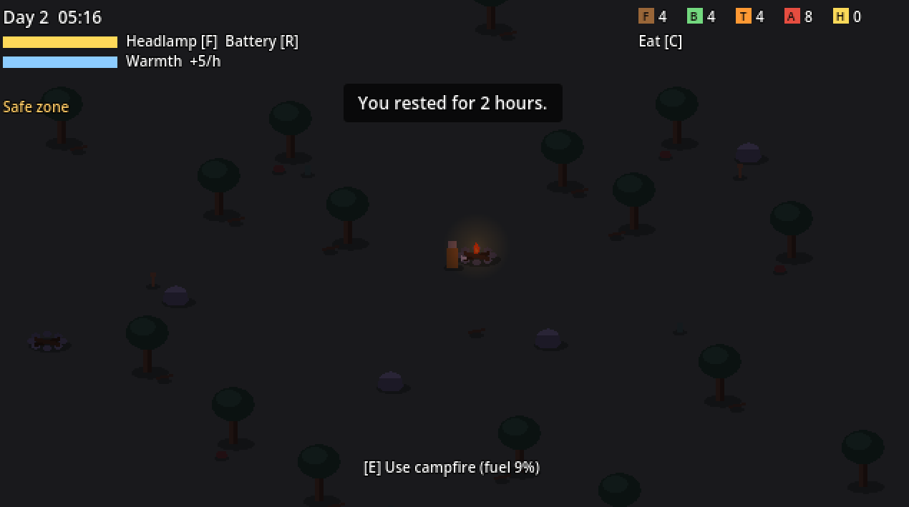 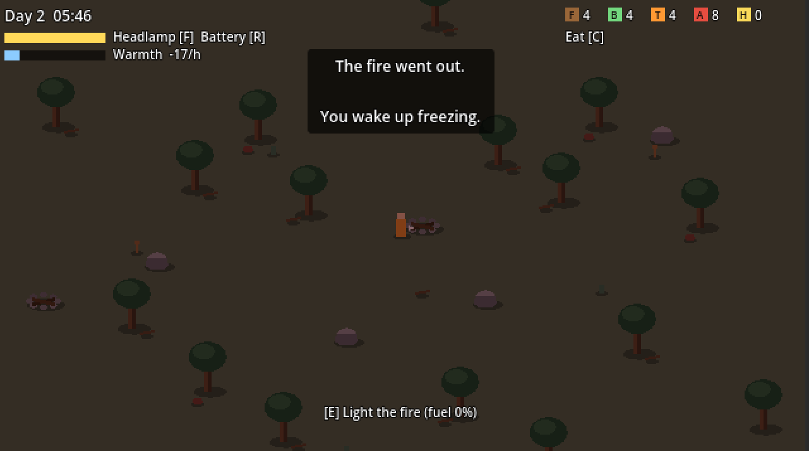

### The main menu looked like a cloudy day
Made it a deep blue night with the campfire as the only warm light.

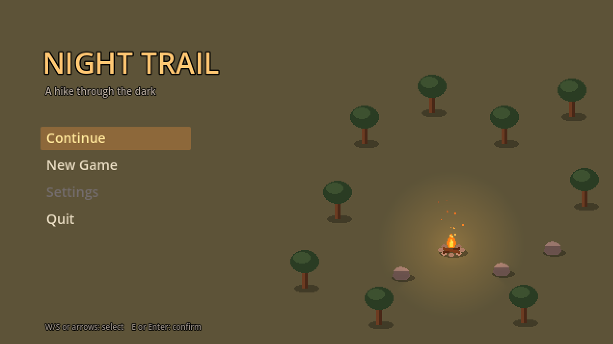 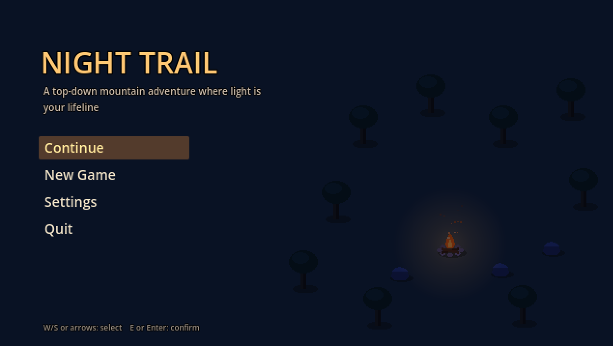

### Torch and baked apple counters looked the same
Every item now has its own colour and letter.

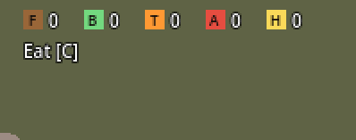

## Playtest

<!-- TODO: what the tester said -->

## Media

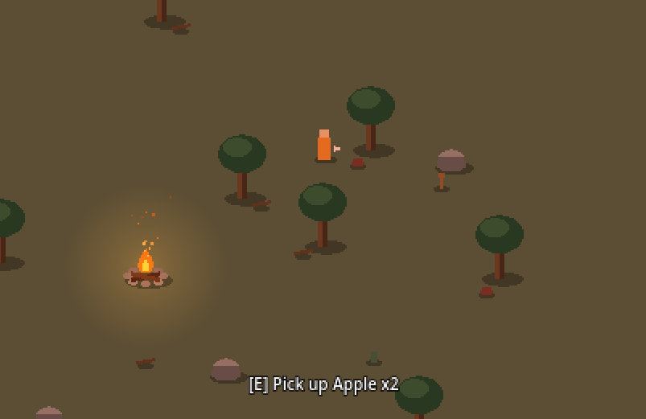
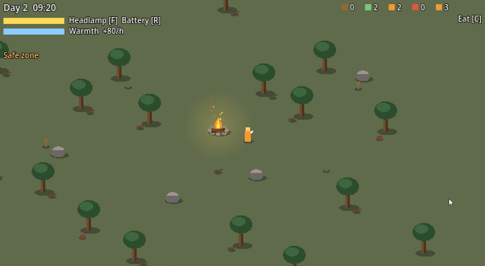
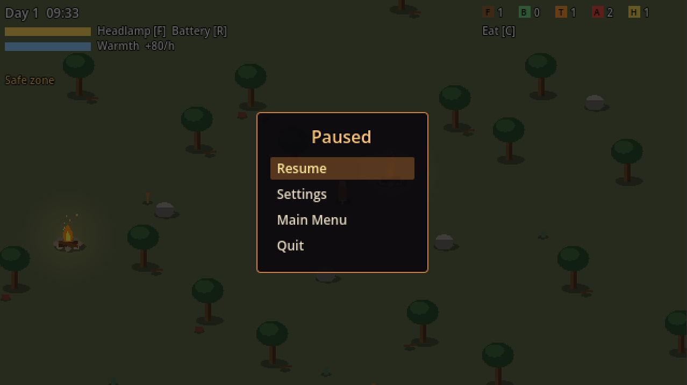
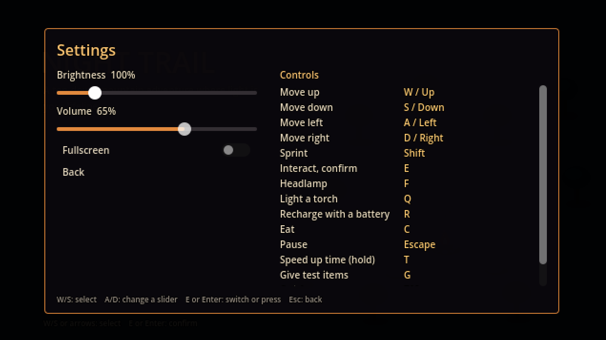

## Next steps

- Two trail sections, hazards and wildlife
- From the backlog: key rebinding, sound, a pixel font
